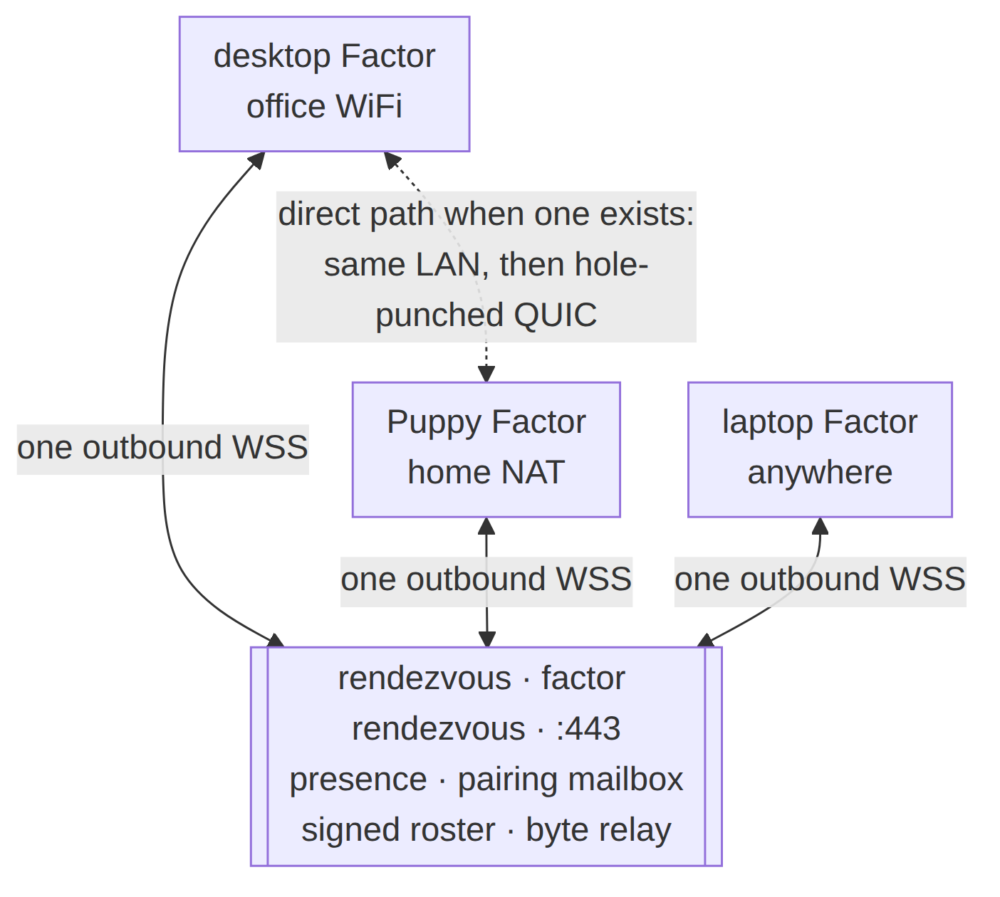

# Swarm — Factor agents working together

A swarm is two or more Factor agents, on any machines in any place, that hand
each other work over the [A2A protocol](https://a2a-protocol.org). Adding an
agent takes two sentences, and the agents already in the swarm learn about the
newcomer on their own.

This page is the design and the development plan. **Nothing here is
implemented yet** (status: 2026-11-26).

## What you do

| You want to | You say | What happens |
|---|---|---|
| Add a machine | To any member: "Add another machine to the swarm." It gives you a code. On the new machine: "Join the swarm," then the code when it asks. | The two agents pair, and every member learns about the new one. |
| Hand off work | "Ask the home box how much disk it has." | A quick answer comes back in the same reply. |
| Hand off slow work | "Have the home box build the property report." | "I passed it to the home box; I'll tell you when it's done." You hear about it once, when it lands. |
| Check on it | "How's it going?" | The last status the other agent reported. |
| Remove a machine | To any member: "Remove the home box from the swarm." | Every member drops it and refuses it from then on. |

Either agent can make the code. Make it on the one you can hear or read, and
enter it on the one you can type into: a synthesized voice reads digits
reliably, and transcription of spoken digits is less certain. On a new machine,
`factor init` shows a code, the way a TV does when you link a streaming
account.

## How it fits together

<!-- A PNG, not a mermaid fence: the GitHub mobile app shows mermaid as raw code.
     Source: docs/assets/swarm-topology.mmd — rebuild with: make diagrams -->

<p align="center">
  
</p>

Every agent keeps one outbound WebSocket on port 443 to its swarm's
rendezvous. That socket carries presence, pairing, the roster and, when no
direct path exists, the A2A traffic itself. The agents encrypt that traffic end
to end, so the rendezvous forwards bytes it cannot read. Agents open no
listening port, so there is no router setting, port forward or firewall prompt
to deal with. When a direct path exists, traffic moves to it.

| Layer | What it is | Why |
|---|---|---|
| Protocol | A2A 1.0, JSON-RPC with SSE streaming, through the official SDK `a2a-go/v2`, wrapped in `internal/a2a` | It is the standard, and the SDK is cheap: +1.05 MB measured, no gRPC linked |
| Session | HTTP/2 over mutual TLS 1.3, with each side's Ed25519 identity pinned at pairing | Only the two agents can read the traffic |
| Path | A relayed WebSocket first, then a direct TCP connection on a shared LAN, then hole-punched QUIC | The relay works everywhere; a direct path is faster and costs nothing |
| Rendezvous | `factor rendezvous`, shipped in the same binary | Anyone can run one |

Speed targets, to be measured in P2–P4:

| Moment | Target |
|---|---|
| Call to a member you talked to recently, relayed | one round trip to the rendezvous, about 40–120 ms |
| The same call on a shared LAN | under 5 ms |
| First call to a member | under 300 ms to the first byte, since the presence socket is already open |
| Pairing, once the code is entered | under 3 s |

A first call never waits for a direct path. It goes over the relay at once
while the agents look for a direct route alongside it, and later requests move
over when one turns up.

## The rendezvous

The rendezvous knows which agent keys are online, holds pairing mailboxes for
ten minutes, keeps each swarm's roster, and relays bytes between two keys
listed in the same roster. It relays for nobody else, so it cannot be used as
an open proxy.

It stores one thing durably: each swarm's roster head, written before any
change is acknowledged or pushed. Everything else lives in memory and rebuilds
as agents reconnect. The store is what makes a removal stick. Without it, a
restarted rendezvous would take the word of whichever member reconnected
first, and a member removed a minute earlier could sign a roster of its own
and fork the swarm. A rendezvous that finds its store missing or damaged
refuses roster changes instead of starting over.

Agents prove their keys with an Ed25519 challenge and a single-use nonce. A
key that no roster lists can do two things: open a pairing mailbox, and claim
one.

The limits against abuse are a token bucket per agent (placeholder: 32 KB/s
sustained, 15 MB a day), a small proof of work to register a key or open a
mailbox, and a rate limit per IP address. The rendezvous writes nothing to
disk that links an IP address to a swarm.

To run your own, put `factor rendezvous` behind a TLS proxy and set
`swarm.rendezvous` on your agents. The URL travels inside the pairing
envelope, so a newcomer inherits it.

The proposed default instance runs in Cyqle's regional cells (open question 1).
It would use the cells, not Cyqle's own relays, which are sized for Cyqle
sessions. Version 1 uses one region. Later, each swarm is homed on one cell, the
roster names it, and codes gain a one-digit cell prefix so a newcomer finds the
right mailbox.

## Pairing

<!-- Source: docs/assets/swarm-pairing.mmd — rebuild with: make diagrams -->

<p align="center">
  
</p>

The two agents run SPAKE2 through
[wormhole-william](https://github.com/psanford/wormhole-william), the
maintained Go client of magic-wormhole (+0.64 MB measured), under a Factor app
id. The rendezvous implements the mailbox side of the magic-wormhole protocol,
and wormhole-william ships a test server to build against.

A code looks like `47-3829-1506`. The first group only finds the mailbox; the
eight digits after it are the password. Whoever controls the mailbox gets one
guess, a one-in-a-hundred-million chance, and a failed exchange burns the code
on both sides. Codes expire after ten minutes. Digits survive speech and
transcription in every language Factor speaks. Spoken digits are normalized
deterministically, and an ambiguous transcription is refused rather than
corrected.

Codes never pass through the model. The agent that makes a code sends it to
you itself, by voice or message, and tells the model only that it did. The
agent that joins asks you for the code directly and hands it to the pairing
step unread. A model provider that saw a live code could claim the mailbox
first.

The key exchange carries a bootstrap envelope: the sponsor's public key, the
swarm id, the rendezvous URL and a one-time pass. The newcomer opens pinned TLS
to the sponsor through the relay, redeems the pass and proves it holds its own
key. The sponsor then signs the next roster.

When the existing member hands out or accepts a code, it says what the new one
will be allowed to do, for example: "It will be able to run commands on this
machine, as root." Only a turn a person started can invite, join, remove or
change grants. A remote, cron, heartbeat or job turn is refused, the way
`config_set` already refuses `tools.disabled` from a heartbeat. On Telegram,
pairing also requires `allow_from`.

Making the code on the joining side, TV style, needs one small addition to
wormhole-william: allocating a mailbox and receiving on the same client.
Choosing a random mailbox number instead would collide now and then, because
claiming a mailbox already in use joins it. P3 starts with that change.

## Membership

The roster says who belongs, and nothing else:

```json
{ "swarm": "…", "epoch": 7, "prev": "<hash of epoch 6>", "home": "wss://…",
  "members": [{ "key": "…", "role": "member" }],
  "removed": ["…"], "signer": "…", "sig": "…" }
```

Names and grants are not in it. Each agent keeps its own label for a member and
its own grants to that member, and members tell each other their names over the
encrypted tunnel. The rendezvous learns which keys belong together and when
that changes. It does not learn what anyone calls a machine or what a machine
may do.

- A roster is valid when it names the previous roster's hash and its signer
  belongs to that previous roster. The rendezvous commits epoch n+1 only on top
  of epoch n.
- Agents take roster changes from the rendezvous they paired through, keep the
  highest committed epoch, and refuse a rollback. Two different rosters with
  the same epoch freeze membership changes and alert you, and the agent keeps
  its last trusted roster meanwhile.
- The rendezvous pushes each committed roster to the members online, and an
  offline member fetches it when it reconnects. Agents connect to a new member
  the first time they need it.
- Any member can remove another. The rendezvous refuses the removed key at
  once, members close its connections and cancel its tasks, and a member whose
  roster is more than seven days old stops accepting privileged tasks until it
  refreshes.
- The `role` field exists from day one, with `member` now and `guest` in P5, so
  a swarm two people share needs no schema change.

The signatures protect the swarm from its members, not from the rendezvous. A
rendezvous that lies can withhold a roster or fork it. Defending against that
needs a stronger design than this one. If you do not trust the default
operator, run your own rendezvous.

## Remote turns

### When another agent asks

A task arrives through `Loop.ProcessRemote` under the session
`a2a:<agent>:<context>`, with one live turn per context, as everywhere else in
Factor. Three existing seams would misfire on a channel named `a2a`, and each
gets an explicit rule:

- `bus.External` would make the remote agent the last chat, so heartbeat and
  restart notices would go to it.
- `SpacePolicy.Scope` would give the turn the private scope.
- The trace would record a user's turn, so the filler would speak.

`ask_user` in a remote turn becomes `INPUT_REQUIRED` to the caller, never a
dialog on the worker's screen. The SDK cancels the producing context at that
state, so the turn runs on a context the gateway owns and waits in memory under
the normal ask timeout. A timeout or a restart fails the task with a stated
reason. Resuming a waiting task after a restart is out of scope.

A small machine runs one remote task at a time (configurable), with a queue of
one. The answer to a task's own question skips the queue. Tasks are kept on
disk for seven days and checked for ownership, and a machine with less than
300 MB of memory free refuses new ones.

### When you hand work off

`swarm_send(agent, message, task?)` waits up to 6 s on a voice turn and 15 s
elsewhere, then turns into a background job. The choice between answering now
and backgrounding is made atomically, so an answer arrives exactly once. The
delegation record is written before the message leaves. After a restart,
Factor checks each record with `GetTask`, because the SDK cannot resubscribe
to a finished task.

Results come back into the session as machine-authored messages. Progress is
silent. A completion, a question from the other agent or a failure is reported,
and "How's it going?" reads the latest status. A question from the other agent
is put to you as the reply, and your next sentence goes back to it.

### Trust and confidentiality

| Rule | Why |
|---|---|
| A remote turn never gets `config_set`, `upgrade`, `pkg_install` or the swarm admin actions. | A remote agent cannot reconfigure, upgrade or re-pair a machine. |
| Everything else follows the member's grant. In a swarm you own, that includes the shell, and on a box where Factor runs as root that is the whole box. | The agent says so when it hands out or accepts the code. |
| The caller's audience rides a Factor A2A extension. Private reaches the worker's private memory; shared, or missing, reaches `shared_space` only. | A remote agent is a new kind of listener. |
| A context keeps the audience it started with, and a wider one starts a new context. | Private history must not answer in a shared room. |
| A result produced in private is held back if the caller's room has since turned shared: "I have private details for when you're alone." | Widening the recall scope does not erase text already in the result. |
| The chain of senders and a hop count ride the same extension. A remote turn cannot pass work on to a third agent unless its grant allows it, a task without that data cannot, and a cycle is refused. | No A→B→A loops. |
| Each member has a daily spending cap (default $1) on top of the session and global caps. A provider's 402 fails the task with that reason and is not retried. | A worker's credits are its owner's money. |

## Cost

You pay nothing beyond your own model bills. The operator of the default
rendezvous pays for the relay. Presence and signaling cost almost nothing, so
the real cost is relayed bytes, and those only flow between agents with no
direct path. As an estimate, 1,000 agents running 50 tasks a day at 20 KiB each
would forward about 31 GB a month if every pair were relayed, or about 62 GB
counting both directions. That suggests €10–30 a month for one region, and
direct paths bring it down. On shared cells, the rendezvous' own container
limits and the per-agent quotas keep it from taking capacity Cyqle needs.

## Development plan

Each phase ships on its own and keeps `make check`, `make lint` and the evals
green.

### P1 — Two agents on one machine (about 4–6 days)

1. SDK spike: prove the input-required bridge on a context the gateway owns,
   and run the A2A conformance kit (`a2a-go/v2/e2e/tck`) against a server that
   speaks only JSON-RPC.
2. Inbound: the `internal/a2a` server (Agent Card, JSON-RPC, SSE),
   `Loop.ProcessRemote`, the task store, the three seam fixes, and an `a2a`
   trigger with no filler.
3. Lifecycle: `ask_user` as `INPUT_REQUIRED`, cancel, a timeout or restart that
   fails the task with its reason, and admission.
4. Outbound: `swarm_send`, delegation records, reconciliation with `GetTask`,
   and exactly-once delivery with the room check.
5. Guards: the sender-chain extension, the per-member cap, typed failures, the
   tool denials, and trace fields for the `a2a` trigger, the peer, the task and
   its outcome.

The transport is loopback HTTP with identities made in the test.

Checkpoint: the conformance kit passes for every method implemented. A
two-agent test covers delegate, question, answer and done; a restart mid-task;
a refused B→A loop; and no private recall in a shared task.

### P2 — Reach anywhere through the relay (about 3–4 days)

1. Identity: an Ed25519 key in `~/.factor/swarm` (mode 0600), with
   certificates valid from 1970 to 2099. The pin carries the trust, so a
   drifted clock on old hardware cannot break a handshake.
2. `factor rendezvous`: challenge authentication, presence, a relay limited to
   one roster, quotas and proof of work.
3. The tunnel: mutual TLS 1.3 and HTTP/2 inside the relayed stream, with the
   A2A client dialing `https://<agent-id>.swarm/` through it. Recently used
   tunnels stay warm with a 15 s keepalive, and presence reconnects after
   sleep, wake or a network change.
4. Operations: one instance deployed behind a TLS proxy, with rendezvous health
   shown in `/health` and the tray.

Checkpoint: two agents in separate network namespaces, behind simulated NAT and
with UDP blocked, complete a task through an in-process rendezvous, and their
latency is measured against the targets.

### P3 — Pairing in two sentences (about 3–4 days)

1. Codes: the allocate-and-receive addition to wormhole-william (upstream if
   accepted), the mailbox side of magic-wormhole in the rendezvous, and
   numeric codes under a Factor app id. Codes reach you from the tool and come
   back to the tool without passing through the model.
2. Enrollment: the bootstrap envelope, pinned redemption, and roster epoch
   n+1.
3. The roster: signed snapshots, the durable roster head, compare-and-swap,
   push, removal, fork detection and the seven-day freshness rule.
4. The `swarm` tool: invite, join, list and remove, under the admin-turn rule,
   and a code step in `factor init`.
5. Speech: digit normalization in Spanish and English, with an eval set of
   transcribed codes.

Checkpoint, live: pair a desktop on office WiFi with a home box that shares no
network with it, add a third agent in two sentences and see the first two learn
about it, then remove it from any member.

### P4 — Direct paths (about 3–5 days)

1. Shared LAN: members publish signed host addresses, and a pair on one LAN
   dials TCP with the same TLS. No new dependency.
2. Hole punching: pion/ice with quic-go (+3.6 MB measured). The first request
   rides the relay, the search for a direct path runs alongside it, and later
   requests move over. IPv4 and IPv6 get separate UDP sockets. There is no TURN
   server, because the relay is the fallback.
3. Measurement: the share of pairs that go direct, warm and cold latency, and
   idle memory on a 3.5 GB machine.

Checkpoint: hole punching ships only if the measurements show a meaningful share
of relayed traffic moving direct. Otherwise it stays on a branch.

### P5 — Beyond your own agents (about 1 week)

A `guest` role whose tools are restricted when they run, not only when listed,
and which gets its own memory space. Third-party A2A agents over plain HTTPS,
with explicit grants for what Factor may tell them. The REST binding and push
notifications.

Until P5, "A2A-compatible" means a spec 1.0 server that passes the conformance
kit and answers Factor members only.

## Settled by measurement

These numbers come from stripped, CGO-free builds. A plain `net/http` program
is 5.38 MB, and Factor today is 17.06 MB.

| Library | Adds | Used for |
|---|---|---|
| `a2a-go/v2` v2.9.0, JSON-RPC server and client | +1.05 MB, no gRPC or protobuf linked; builds for Windows, macOS arm64 and `GOAMD64=v1` | A2A, from P1 |
| `wormhole-william` v1.0.8 | +0.64 MB | Pairing, from P3 |
| `pion/ice` v4 with `quic-go` | +3.6 MB | Hole punching in P4, if it earns its place |
| `pion/webrtc` v4 | +5.3 MB | Rejected: more than ICE needs, for a browser peer nobody needs yet |
| `go-libp2p`, trimmed | +16.6 MB | Rejected: doubles the binary |
| `tailscale.com/tsnet` | +17.2 MB | Rejected: doubles the binary and needs a coordination server |

A2A 1.0 is final (1.0.0 on 2026-03-12, 1.0.1 on 2026-05-28). The SDK stops
processing a task at `INPUT_REQUIRED` and cancels the context that produced
it.

<details>
<summary><b>Alternatives considered</b></summary>

The requirements widened partway through the design, from one LAN to agents
anywhere with P2P preferred.

| Proposal | Outcome |
|---|---|
| Hand-written JSON-RPC instead of the SDK | Dropped once the SDK measured +1.05 MB with no gRPC linked |
| A2A as an ordinary bus channel | Rejected: it would read private memory and become the last chat |
| Saving a waiting task and resuming it after a restart | Deferred: the waiting turn stays in memory, and a restart fails it |
| Every handoff in the background | Replaced by a short wait, then the background |
| Spoken progress updates | Replaced by silent progress and status on request |
| LAN-only pairing with a pasted invite and a self-signed certificate | Superseded by the rendezvous and short codes |
| Reusing Cyqle's own relays | Rejected: they are sized for Cyqle sessions |
| tsnet, an embedded Tailscale node | Rejected: doubles the binary and needs a coordination server |
| TURN as the last resort | Replaced: the rendezvous relay is the fallback |
| Relay only, with no plan for P2P | Relay first, then P2P in P4, decided by measurement |
| A hand-written CPace key exchange | Rejected in favour of a maintained library |
| A roster encrypted under a rotating swarm key | Rejected: the rendezvous needs member keys to relay; names and grants stay off the roster instead |
| A rendezvous with no durable state | Rejected: a removed member could fork the roster after a restart |
| Six or ten secret digits | Eight: one guess per code, short enough to read aloud |
| Removing `USER.md` from shared remote turns | Kept: the same prompt-level holding back the voice room uses, which the live eval covers |

</details>

## Open questions

1. Which domain and operator the default rendezvous uses, for example
   `swarm.fctr.app` on a Cyqle cell.
2. The free quotas: 32 KB/s and 15 MB a day per agent are placeholders.
3. How a swarm's home cell is chosen once there is more than one region.
4. How a rendezvous that lost its store is re-seeded, and who confirms it.
